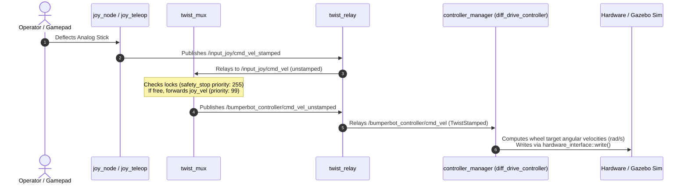
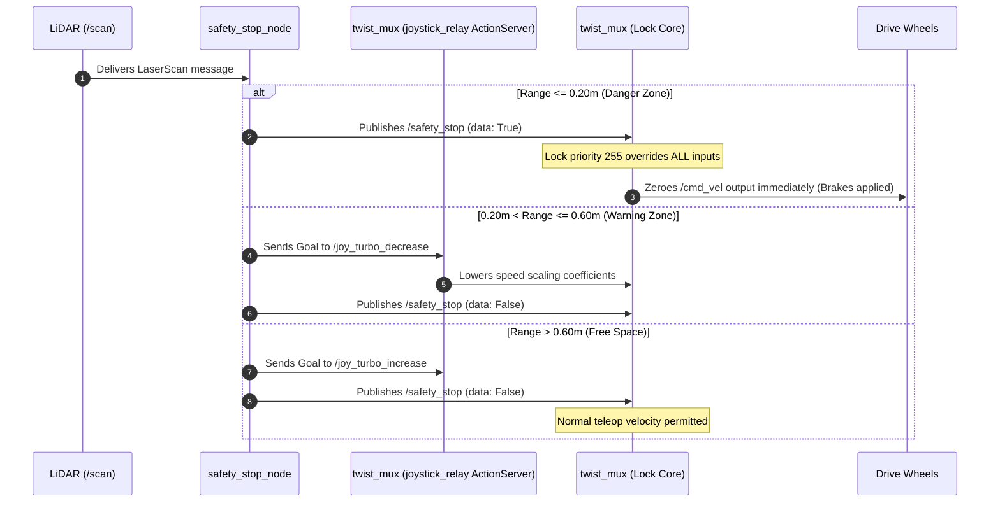
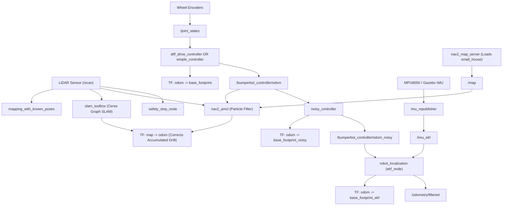

# 02 - System Architecture & Component Interaction

## A. Objective

This document details the multi-tiered system architecture of BumperBot. It outlines how low-level microcontrollers, ROS 2 control loops, perception supervisors, probabilistic state estimators, and mapping pipelines integrate into a cohesive AMR framework.

---

## B. Architectural Layering Model

The software architecture is partitioned into seven distinct, decoupled operational tiers:

```
+----------------------------------------------------------------------------------------------------+
|                                    TIER 7: USER & OPERATOR INTERACTION                              |
|           [RViz2 Visualization]                 [Linux Gamepad / Keyboard Teleop]                  |
+----------------------------------------------------------------------------------------------------+
                                      |                                   |
                                      v                                   v
+----------------------------------------------------------------------------------------------------+
|                               TIER 6: GLOBAL LOCALIZATION & SLAM TIER                               |
|   [nav2_map_server]  <--->  [nav2_amcl Particle Filter]   OR   [slam_toolbox Graph Optimizer]        |
|   (map broadcast)          (publishes map -> odom TF)          (publishes map -> odom TF)           |
+----------------------------------------------------------------------------------------------------+
                                      ^                                   ^
                                      | (laser scan & odom)               | (laser scan & odom)
+----------------------------------------------------------------------------------------------------+
|                               TIER 5: STATE ESTIMATION & FUSION TIER                                |
|   [robot_localization EKF]          [1D Kalman Filter]          [Odometry Motion Model Samples]     |
|   Fuses odom_noisy + imu            Experimental linear filter   Probabilistic particle cloud       |
+----------------------------------------------------------------------------------------------------+
                                      ^
                                      | (raw odometry & IMU data)
+----------------------------------------------------------------------------------------------------+
|                               TIER 4: SUPERVISORY & REACTIVE SAFETY                                 |
|   [safety_stop_node]                                                                                |
|   Monitors /scan: Warning Zone -> /joy_turbo_decrease  |  Danger Zone -> /safety_stop [Lock 255]    |
+----------------------------------------------------------------------------------------------------+
                                      |
                                      v (emergency inhibitor signal)
+----------------------------------------------------------------------------------------------------+
|                               TIER 3: VELOCITY MULTIPLEXING & RELAYS                               |
|   [twist_mux]                        <--- Joy (99) / Key (90) / Nav (20) / Explore (10) / Locks: 255|
|   [twist_relay]                      Translates Twist unstamped <-> TwistStamped                    |
+----------------------------------------------------------------------------------------------------+
                                      |
                                      v /bumperbot_controller/cmd_vel (TwistStamped)
+----------------------------------------------------------------------------------------------------+
|                               TIER 2: ROS 2 CONTROL & KINEMATICS                                    |
|   [controller_manager]               Loads diff_drive_controller & joint_state_broadcaster          |
|   [simple_controller]                Analytical kinematic conversion & odometry integrator          |
+----------------------------------------------------------------------------------------------------+
                                      |
                                      v
+----------------------------------------------------------------------------------------------------+
|                               TIER 1: HARDWARE ABSTRACTION & SIMULATION                             |
|   SIMULATION: [ign_ros2_control] <-> Ignition Gazebo Fortress 6 Physics                             |
|   PHYSICAL:   [BumperbotInterface] <-> LibSerial (/dev/ttyUSB0) <-> Arduino Dual PID Firmware        |
|               [mpu6050_driver]     <-> Linux I2C (/dev/i2c-1)   <-> MPU6050 6-DoF Sensor            |
+----------------------------------------------------------------------------------------------------+
```

### Navigation and Mission Layer (`bumperbot_navigation`)

On top of the tiers above, the Nav2 servers (`planner_server`, `controller_server`, `behavior_server`, `bt_navigator`) turn a `NavigateToPose` goal into velocity commands on `nav_vel` (a `twist_mux` input, priority 20), using the `map` from `map_server`, `map -> odom` from AMCL and `/scan`. The `mission_manager` (C++ or Python) sits above Nav2: it exposes `/execute_mission` and `/mission/status`, sends one `NavigateToPose` goal per station and verifies the reached pose through TF `map -> base_footprint`. It depends only on that action, TF and its own interfaces, not on the simulator. The `twist_mux` priorities are joystick 99 > keyboard 90 > docking 30 > navigation 20 > exploration 10, with the `safety_stop` lock (255) above all. See [10_navigation.md](10_navigation.md).

**Docking layer.** `dock_manager` (C++ or Python) serves `/dock_robot` (`DockRobot`): it uses Nav2 only to reach the dock staging pose, then drives the last 0.5 m itself on `dock_vel` (a `twist_mux` input, priority 30), closed loop on `odom -> base_footprint` and refined by the abstract detection topic `/dock/detected_pose`. It reads `/safety_stop` but never publishes it, so the lock (255) keeps winning over docking. `battery_monitor` closes the loop: low `/battery_state` -> cancel the mission -> DOCK -> charge -> UNDOCK. Simulation-only pieces are `battery_sim` (battery model) and, in `bumperbot_mujoco`, `dock_marker_sim` plus the `/mujoco/ground_truth` topic; none of them is started by `real_robot.launch.py` or `docking.launch.py`. `dock_sim.launch.py` composes everything for simulation.

---

## C. End-to-End Runtime Data Flow Pipelines

### 1. Actuation & Motion Control Pipeline



### 2. Autonomous Safety Stop Pipeline



### 3. Perception, Mapping & Localization Pipeline



---

## D. Process & Concurrency Architecture

### 1. Multi-Threaded vs. Single-Threaded Node Execution
In ROS 2 Humble, callback queues are processed by Executors. The repository contains critical concurrency designs:
- **`SingleThreadedExecutor` (Standard Nodes)**: Nodes like `twist_relay` and `imu_republisher` execute callbacks sequentially, preventing internal race conditions without requiring mutex locks.
- **`MultiThreadedExecutor` (Perception & Mapping Nodes)**:
  `mapping_with_known_poses.py` uses a `MultiThreadedExecutor`. This is mandatory because `scan_callback` requests interpolated transforms from `tf_buffer` with a blocking timeout. If a `SingleThreadedExecutor` were used, waiting on `lookup_transform` would block the single executor thread from servicing the `/tf` subscriber callbacks, resulting in a self-inflicted deadlock.

### 2. Managed Lifecycle Node Architecture
Both `bumperbot_localization` and `bumperbot_mapping` integrate the ROS 2 Managed Lifecycle design:
- Nodes: `nav2_map_server`, `nav2_amcl`, `map_saver_server`, and `slam_toolbox`.
- Supervisor: `nav2_lifecycle_manager`.
- The manager transitions nodes deterministically through the standard ROS 2 finite state machine:
  $$\text{Unconfigured} \xrightarrow{\text{configure}} \text{Inactive} \xrightarrow{\text{activate}} \text{Active}$$
- This guarantees that AMCL never attempts to process LiDAR scans until `map_server` has fully loaded the map file and published map metadata into shared memory.

